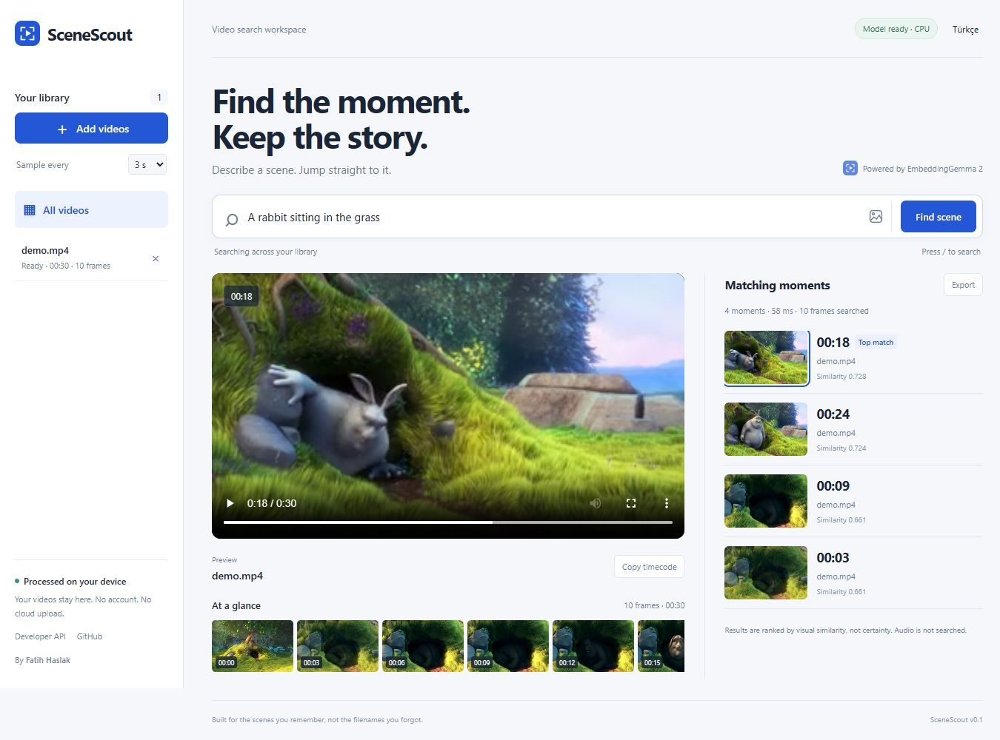
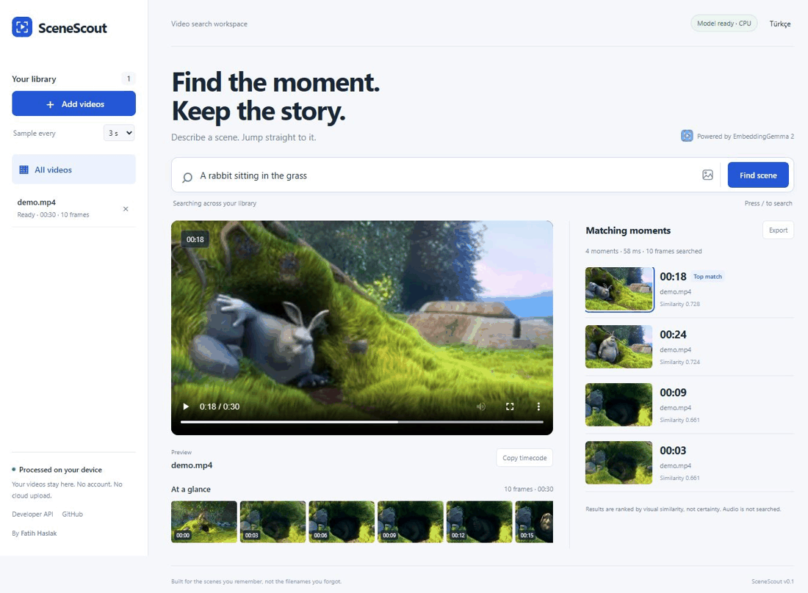
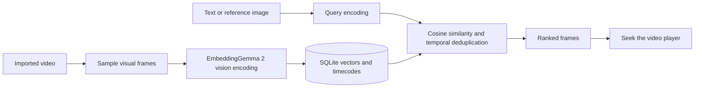

<p align="center"></p>
<h1 align="center">SceneScout</h1>
<p align="center"><strong>Find the moment you remember.</strong><br>Private, local visual video search with Google EmbeddingGemma 2.</p>
<p align="center"><a href="README.tr.md">Türkçe</a> · <a href="#quick-start">Quick start</a> · <a href="docs/architecture.md">Architecture</a> · <a href="docs/performance.md">Measured demo</a> · <a href="SECURITY.md">Privacy</a></p>



You remember a scene, not its filename. Add a video, describe what you saw, and jump to the matching moment. Or use a reference image to find a visually similar frame.

SceneScout uses real embeddings from `google/embeddinggemma-2`. No hosted inference API, generated captions, or canned search result fallback.

## See it work



This animation combines three real application screenshots. The demo uses a 30-second excerpt of *Big Buck Bunny*. It is not a retrieval benchmark. [Media attribution and changes](examples/ATTRIBUTION.md).

## Features

- English/Turkish scene queries and reference-image search.
- Clickable results, seek-to-timecode playback and an interactive filmstrip.
- Adjustable sampling, indexing progress and content-hash deduplication.
- Library-wide or single-video search, timecode copying and JSON export.
- Bilingual, responsive UI with keyboard access and local assets.
- Documented local API, OpenAPI schema, locked dependencies and pinned model revision.

## Quick start

Requires **Python 3.12 or 3.13** and [uv](https://docs.astral.sh/uv/getting-started/installation/). Leave several GB of RAM and disk space free. CPU inference works; indexing is slower than text search.

```sh
git clone https://github.com/Fatih-Haslak/scenescout.git
cd scenescout
uv run --frozen scenescout --open-browser
```

Open [http://127.0.0.1:8765](http://127.0.0.1:8765). Windows: double-click **Start.cmd**. macOS/Linux: `sh start.sh`. Stop the server with Ctrl+C in its terminal.

1. Add an H.264 MP4 or WebM video.
2. Wait for **Ready**. First use downloads approximately 1.5 GB of weights from Hugging Face.
3. Describe the scene, or use the image icon to supply a reference image.
4. Choose a result to seek to its sampled timecode.

No API key or account is required for this public model. Cached dependencies and weights allow local inference; set `HF_HUB_OFFLINE=1` for strictly offline model loading.

### Reproduce the demo

```sh
uv run --with imageio-ffmpeg python examples/create_demo.py
```

Import `examples/demo.mp4` with a **3-second** interval. Try `A rabbit sitting in the grass`, `Çimenlerde oturan bir tavşan`, or `A dark cave inside a tree`. The first two selected 00:18 in the recorded demo. [Actual exported response](examples/search-results.json).

The optional script downloads the licensed film from Blender Foundation. Downloaded media is excluded from Git.

## How it works



Each sampled frame is embedded as an image. The audio tower is disabled; this release does not process whole video sequences or reason over motion. Text uses the model's `SearchQuery` prompt. Normalized 768-dimensional float32 vectors are persisted in SQLite. Inference uses float32 on CPU or bfloat16 on compatible CUDA devices, never float16.

Windows defaults to CPU PyTorch. A matching CUDA installation of PyTorch and torchvision enables GPU detection. GPU speed was not measured for this release. [PyTorch installation](https://pytorch.org/get-started/locally/).

## Developer API

Run the app and open [local API docs](http://127.0.0.1:8765/docs) or [OpenAPI JSON](http://127.0.0.1:8765/openapi.json). The documentation uses local assets and works offline.

```sh
curl http://127.0.0.1:8765/api/search \
  -H 'Content-Type: application/json' \
  -d '{"query":"a rabbit sitting in the grass","limit":12}'
```

FastAPI, SQLite, NumPy and OpenCV power the backend. Plain JavaScript and CSS ship inside the Python wheel; no frontend build or Node installation is needed. [Architecture and tradeoffs](docs/architecture.md).

## Current limits

- Visual search only: no speech search, motion tracking, captions or clip export.
- Sampling can miss brief events; timecodes are sampled moments, not event boundaries.
- Per video: **512 MB**, **2 hours**, **2,000 sampled frames**. Filmstrip: up to 80 thumbnails.
- Similarity is a ranking, not a confidence percentage. Unrelated queries still return nearest neighbors.
- Search scans vectors in memory. Large archives will need a dedicated vector index.
- One indexing worker; search can wait for the current frame. Interrupted imports can be removed and re-imported.
- Browser codec support varies; H.264 MP4 is recommended.
- Windows CPU operation was observed. macOS/Linux and CUDA execution are unverified in this release.

## Privacy and licensing

Copies and indexes live in `.data/`; override with `SCENESCOUT_DATA_DIR`. Model files use Hugging Face's cache. Removing an import leaves the original untouched. Keep this single-user server on loopback; do not publish it through a tunnel. [Security notes](SECURITY.md).

Code: **MIT**. Model weights: **Apache 2.0**, downloaded separately. Demo imagery: **CC BY 3.0**, with [attribution](examples/ATTRIBUTION.md). Independent project; no Google or Blender Foundation affiliation.

Built by [Fatih Haslak](https://github.com/Fatih-Haslak). [Contributing](CONTRIBUTING.md).

References: [model card](https://huggingface.co/google/embeddinggemma-2), [Google's multimodal guide](https://ai.google.dev/gemma/docs/embeddinggemma/multimodal-embeddinggemma-with-sentence-transformers).
