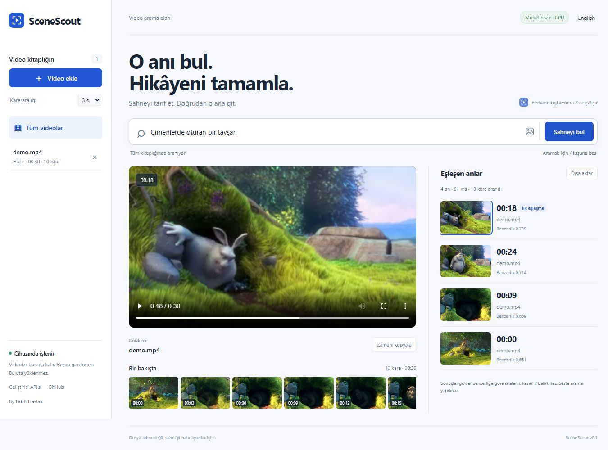

# SceneScout

**Hatırladığın sahneyi bul.** Google EmbeddingGemma 2 ile yerelde çalışan görsel video arama uygulaması.

[English README](README.md) · [Mimari](docs/architecture.md) · [Ölçülen örnek](docs/performance.md)



Video ekle, gördüğün sahneyi tarif et ve sonuçtan o ana git. İstersen örnek bir görselle benzer kareleri bul. Video, sorgu ve referans görselleri bir bulut çıkarım servisine gönderilmez.

## Kurulum

**Windows için kolay kurulum:** [v0.3.1 paketini](https://github.com/Fatih-Haslak/scenescout/releases/tag/v0.3.1) indir, ZIP’i bir klasöre çıkart ve `Start.cmd` dosyasına çift tıkla. Python, bağımlılıklar ve YouTube çalışma ortamı otomatik hazırlanır; elle Python/uv kurmak gerekmez. İlk açılış internet ve birkaç GB boş alan gerektirir. NVIDIA GPU için `Start-GPU.cmd` kullanılabilir. [Kurulum ayrıntıları](docs/installation.md).

Kaynak koddan kurmak için Python 3.12/3.13 ve [uv](https://docs.astral.sh/uv/getting-started/installation/) kullan:

```sh
git clone https://github.com/Fatih-Haslak/scenescout.git
cd scenescout
uv run --frozen --extra cpu scenescout --open-browser
```

Windows’ta **Start.cmd** dosyasına çift tıklayabilirsin. İlk açılışta bağımlılıklar, ilk videoda yaklaşık 1,5 GB model dosyası indirilir. Uygulamayı [http://127.0.0.1:8765](http://127.0.0.1:8765) adresinde kullan. Sunucuyu terminalinde Ctrl+C ile durdur.

1. **Video ekle** ile H.264 MP4 veya WebM seç; ya da **Bağlantıdan ekle** ile herkese açık YouTube/Shorts veya X/Twitter video adresi yapıştır.
2. İndeksleme bitip **Hazır** yazmasını bekle.
3. “Çimenlerde oturan bir tavşan” gibi bir sahne tarif et.
4. Sonuca tıkla; oynatıcı ilgili zaman koduna gider.

Görsel simgesiyle bir referans görsel yükleyebilir, zaman çizelgesinden videoyu gezebilir ve sonuçları JSON olarak dışa aktarabilirsin. Dil düğmesi Türkçe ve İngilizce arasında geçiş yapar.

**En az benzerlik** filtresi zayıf sonuçları gizler. Filtreyi geçen kare bulunamazsa uygulama bunu açıkça gösterir. Eşik doğruluk yüzdesi değildir; yüksek bir eşik doğru sahneleri de gizleyebilir. Varsayılan seçenek en yakın sahneleri gösterir.

v0.3.1, YouTube 403 hatasından sonra herkese açık alternatif akışı bir kez dener. İndirme boyutu ses ve görüntü akışlarının toplamında denetlenir; Windows ilerleme dosyasındaki geçici kilitler yeniden denenir. Kitaplık yenilemelerinin birden fazla sorgulama döngüsü başlatması da giderildi.

Yarım kalan indeksler kayıtlı kareleri korur. Kitaplıktaki **İndekslemeye devam et** düğmesiyle yeniden yüklemeden devam edebilirsin. Silme sırasında uygulama kapanırsa temizlik sonraki açılışta tamamlanır.

## Doğrulama ve ölçümler

74 davranış testi; Windows/Linux ve Python 3.12/3.13 için otomatik kontroller. Gerçek model ayrıca CPU ve RTX 4060 Ti GPU üzerinde çalıştırıldı. Üç filmden 55 kare ve 36 Türkçe/İngilizce sorgudan oluşan küçük geliştirme setinde doğru sahne 24 sorguda ilk sırada, 36 sorgunun tamamında ilk beşte bulundu. Isınmış metin aramasında ortanca süre CPU’da 66 ms, GPU’da 32 ms ölçüldü.

Bağlantı indirmeleri arka planda çalışır; iptal edilebilir ve yarım kalırsa baştan yeniden denenebilir. İndirilen kopya H.264 MP4’e dönüştürülür. **Kaynağı aç** düğmesi orijinal paylaşımı gösterir. Tekil, herkese açık videolar desteklenir; canlı yayın, hesap girişi ve konuşma/özet üretimi yoktur. Platform erişimi engellerse hata gösterilir. [Bağlantı desteği ve gerçek örnekler](docs/link-imports.md).

Bu küçük set genel doğruluk garantisi değildir. Beklenen sahneler aramalardan önce kaydedildi; ilk sonucu kaçıran sorgular da raporda yer alır. [Ham sonuçlar, yöntem ve tekrar çalıştırma](docs/evaluation.md).

## Örnek video

```sh
uv run --with imageio-ffmpeg python examples/create_demo.py
```

Oluşan `examples/demo.mp4` dosyasını 3 saniyelik kare aralığıyla ekle. Blender Foundation’ın *Big Buck Bunny* filminden 30 saniyelik sessiz bir kesittir. [Lisans ve kaynak](examples/ATTRIBUTION.md).

## Sınırlar

- Bu sürüm **videonun görüntüsünde** arama yapar. Sesi veya konuşmayı aramaz; hareketi takip etmez.
- Örnekleme kısa olayları kaçırabilir. Zaman kodları örneklenen karelere aittir.
- Video başına 512 MB, iki saat ve 2.000 kare sınırı vardır. Kare aralığını artırmak indeksleme maliyetini azaltır.
- Benzerlik puanı doğruluk yüzdesi değildir. Filtre kapalıyken ilgisiz sorgular da en yakın sonuçları getirir. Filtre tüm yanlış eşleşmeleri otomatik saptama garantisi vermez.
- CPU için `--extra cpu`, uyumlu NVIDIA GPU için `--extra cuda` seçilir. GPU ölçümü RTX 4060 Ti ile yapıldı.
- Kopyalar ve indeks `.data/`, model dosyaları Hugging Face önbelleğindedir. Videoyu kaldırmak orijinalini silmez.
- İndirmeler tamamlandıktan sonra yerelde çalışır. Tam çevrimdışı model yüklemek için `HF_HUB_OFFLINE=1` kullanılabilir.

Tek kullanıcı için hazırlanmıştır. Sunucuyu internete açma. [Gizlilik ve güvenlik](SECURITY.md).

Kod lisansı MIT, model Apache 2.0, örnek film görüntüleri CC BY 3.0’dır.

[Fatih Haslak](https://github.com/Fatih-Haslak) tarafından geliştirildi.
