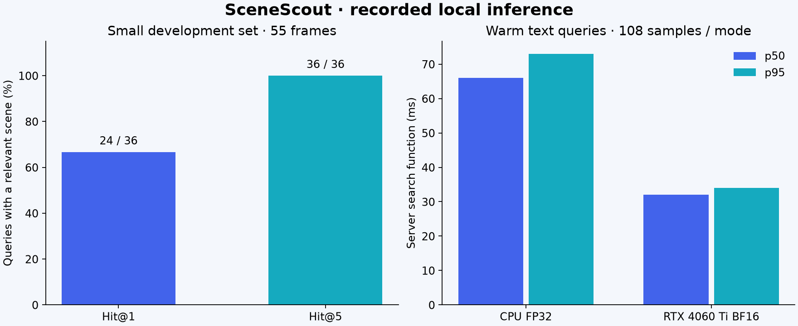

# SceneScout v0.2 measurements

Recorded 2026-10-10 on Windows 11, Python 3.13.9, Ryzen 5 7500F, RTX 4060 Ti 16 GB. Model revision `914f7f89142e33e77833254d9c9b90c3cef7303b`. CPU PyTorch 2.14.1+cpu; CUDA PyTorch 2.14.1+cu130. Batch size 2; sampling every 3 seconds.

## Retrieval quality

Three licensed animated excerpts: *Big Buck Bunny* (60 s), *Sintel trailer* (45 s), *Elephants Dream* (60 s). **55 frames**, **18 paired scene descriptions**, **36 queries** (18 English + 18 Turkish), searched across all three videos. Contact sheets and relevance windows were fixed before model queries; query-file SHA-256 `30d69a84c582d1d4b87ee240e49819b7e397de964b3ff120763a0ea81edb5a33`.

Hit@k means at least one labelled relevant sampled frame appears in the first k temporally deduplicated results. MRR@12 is the mean reciprocal rank of the first relevant result (zero if absent). These metrics describe this small development set, not a general accuracy guarantee.

| Runtime | Hit@1 | Hit@5 | MRR@12 | Warm p50 / p95 |
| --- | --- | --- | --- | --- |
| CPU / FP32 | 66.7% | 100.0% | 0.801 | 66 / 73 ms |
| RTX 4060 Ti / BF16 | 66.7% | 100.0% | 0.800 | 32 / 34 ms |

24/36 queries put the labelled frame first; 36/36 put it in the first five. The paired languages both achieved 12/18 first-result hits. Full rankings, including first-result misses, are committed in [CPU results](../evaluation/results-cpu-b2.json) and [CUDA results](../evaluation/results-cuda-b2.json).



## Startup and indexing cost

| Runtime | Cached model load | First text encoding including load | Index all 55 frames after model load | Process RSS after run |
| --- | --- | --- | --- | --- |
| CPU | 10.50 s | 10.58 s | 177.40 s | 2486 MiB |
| GPU | 20.87 s | 21.18 s | 5.36 s | 2088 MiB |

The first text encoding is measured directly through the encoder; warm timings use the application's search function (encoding + metadata lookup + exact ranking). 108 warm latency samples per mode, three repetitions of the same 36 queries. Installation, model download, HTTP transit and UI rendering are excluded. The CPU and GPU runs partially overlapped on the host, so the table is not a controlled isolated speedup comparison. RSS includes libraries/model; it is not peak memory. GPU peak allocated tensor memory: 1006 MiB, excluding driver and other applications.

## Longer-video throughput

The full **596.5-second** *Big Buck Bunny* film (about 10 minutes), **199 frames** at 3-second sampling, indexed in **23.55 seconds** on CUDA after model load. This is one full-video run at the source's 320×180 resolution, not a 1080p/4K or two-hour-video benchmark. [Raw measurements](../evaluation/scaling-results.json).

## Exact scan and cache scaling

Synthetic normalized 768-dimensional vectors, seeded with `20261010`, distributed into videos of at most 2,000 frames. This isolates CPU vector-cache/ranking costs; no model or real media is encoded for this section. Cache rebuilding after a library change pays the initial snapshot cost again.

| Vectors | Raw matrix | First snapshot | Cached ranking p50 / p95 | Uncached snapshot + ranking p50 |
| --- | --- | --- | --- | --- |
| 1,000 | 2.9 MiB | 14.87 ms | 0.14 / 0.26 ms | 13.91 ms |
| 10,000 | 29.3 MiB | 133.46 ms | 0.79 / 1.07 ms | 124.38 ms |
| 50,000 | 146.5 MiB | 632.29 ms | 5.88 / 6.51 ms | 650.15 ms |

Cached timings use 20 repetitions; uncached timings use five. These are sample percentiles. Query encoding is excluded. Exact scanning remains O(N × 768), with O(N log N) sorting and additional metadata memory. 50,000 vectors require ~146 MiB for the raw matrix; very large archives still need a dedicated vector index.

## Reproduce

```sh
uv sync --frozen --extra cpu --group evaluation
uv run --no-sync python examples/create_demo.py
uv run --no-sync python evaluation/prepare.py
uv run --no-sync python evaluation/run.py --device cpu --batch-size 2
# On a compatible NVIDIA machine:
uv sync --frozen --extra cuda --group evaluation
uv run --no-sync python evaluation/run.py --device cuda --batch-size 2
uv run --no-sync python evaluation/scaling.py
uv run --no-sync python evaluation/report.py
```

Each evaluation run stores its isolated library under `work/`; it does not touch your `.data` library. CPU-only machines can reproduce the CPU report and annotations; CUDA/scaling measurements require compatible hardware. Scripts fail visibly on inference/decode errors. No fallback vectors or prewritten search responses are used in the evaluation.

## Scope of evidence

The annotations were made by Codex from visible contact sheets, with no human adjudication. This is a public development set of animation, with paired translations rather than 36 independent scenes. There is no blind held-out test set, live-action footage, negative-query rejection metric, concurrency latency benchmark or claim about audio/motion understanding. Small windows sometimes make visually related shots count as misses; the raw rankings preserve those cases.

Inspect [queries and relevance windows](../evaluation/queries.json), [media hashes](../evaluation/media-manifest.json), and [media licences](../evaluation/ATTRIBUTION.md). Contact sheets: [Bunny](evaluation-bunny.jpg), [Sintel](evaluation-sintel.jpg), [Dream](evaluation-dream.jpg). Historical v0.1 observations remain in [performance.md](performance.md).
